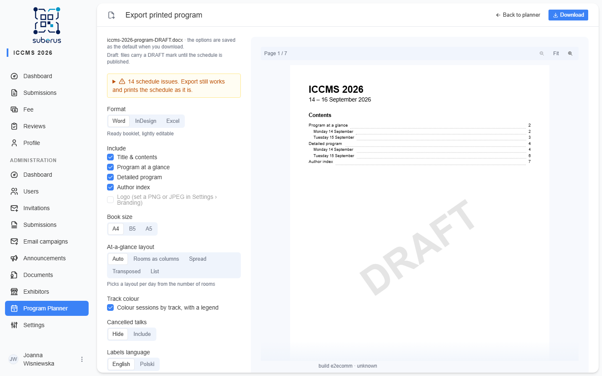

import { Aside, Steps } from '@astrojs/starlight/components';

Turn the schedule into an offline document: a **Word** booklet you can print as is, an
**InDesign** (IDML) package to hand to a designer, or an **Excel** workbook with the raw
data. All three are built from the same program, so session codes and times match
everywhere.

<Aside type="note" title="Where to find it">
The **Export ▾** button in the planner header, next to **Publish**. Pick a format to open
the export page.
</Aside>

## How to export

<Steps>

1. In the planner header, open **Export ▾** and choose **Word**, **InDesign** or **Excel**.

2. Set the options in the left panel (see the table below). The preview on the right
   updates as you change them; scroll it to see further pages — the bar at the top
   shows the current page and has zoom buttons for checking small grid text.

3. If a **schedule issues** note is shown, open it to see the full list. Export still
   works, but the file prints the schedule exactly as it is; **Fix in the planner** takes
   you back.

4. Click **Download** in the page header. The top of the panel shows the file name
   (e.g. `iccms-2026-program-DRAFT.docx`) or, when the download is blocked, the reason.
   The options you used are saved and pre-filled next time.

</Steps>

<Aside type="caution" title="Draft programs">
Until the schedule is **Published**, files are marked as drafts: the file name ends in
`-DRAFT`, the panel says so, Word and the preview show a diagonal **DRAFT** watermark, and InDesign puts
the mark on its own layer (**Draft mark**) behind the content so a designer can hide it.
</Aside>

## Options

| Option | What it does | Excel |
|---|---|---|
| **Format** | Word (`.docx`), InDesign (`.idml`) or Excel (`.xlsx`). | — |
| **Include** | Which parts go into the file: *Title & contents*, *Program at a glance*, *Detailed program*, *Author index*, and the conference *Logo*. At least *Program at a glance* or *Detailed program* must stay on; otherwise the group is marked and Download is disabled. | Parts become sheets; title and logo are not used |
| **Book size** | Page size of the booklet: A4, B5 or A5. | Hidden |
| **At-a-glance layout** | *Auto* picks a layout per day from the number of rooms: rooms as columns (landscape from 5 rooms on A4, 4 on A5), a two-page spread, or a transposed grid for very many rooms. Pick one to use it for every day; *List* prints a time-block list instead of a grid. The hint under the control explains the selected layout. Days follow one another on the same pages; a two-page spread or a change of orientation starts a new page. Breaks, events and — when the day uses two or more rooms — sessions with nothing else at that time span all columns. | Hidden; always rooms as columns |
| **Detailed program layout** | *Grid* (default) prints each day as tables, one per block of parallel sessions: a grey band with the block's time, then one column per room headed by the room, session code and title on a light tint of the track colour, a *Chair* row, and one row per talk with its time turned sideways on the left. A talk shows its badge or *Invited* underlined, the title, the presenter in bold with their academic title (taken from the presenter's account) and their affiliation in italics; co-authors are left out. When rooms run talks of different lengths the time column is dropped and each talk shows its own time. Breaks and events are full-width bands, and poster sessions list their boards (P1, P2…). A day with more than 3 rooms side by side (2 on A5) turns landscape, and a block wider than 5 rooms (4 on B5, 3 on A5) is split into several tables. *List* prints the sessions one after another with all authors. | Hidden |
| **Track colour** | *Colour sessions by track, with a legend*: a coloured bar on each session in the at-a-glance grid and a tinted room header in the detailed grid. | A coloured left edge on each session in the day grids |
| **Cancelled talks** | *Hide* leaves cancelled talks out; *Include* prints them struck through. | Adds a *Cancelled* column |
| **Labels language** | Language of fixed labels (Room, Chair, weekdays, headings, column names). Titles and names are printed as entered. | Column and sheet names |

<Aside type="note" title="Logo">
The logo comes from **Settings › Branding**. Only PNG and JPEG logos can be printed; with
another format the *Logo* box is disabled.
</Aside>

## What each format contains

| Format | Contents |
|---|---|
| **Word** | Title and contents (with page numbers), *Program at a glance* grids, *Detailed program* day by day, *Author index* in two columns. Named paragraph and character styles (e.g. *SessionHeading*, *Presenter*) so you can restyle the whole booklet at once. |
| **InDesign** | The same parts as threaded stories with named paragraph, character, table and cell styles, one swatch per track (*Track: name*; the detailed grid's headers use tints of it) and a ready **Program TOC** style — run *Layout › Table of Contents* to build the contents. InDesign adds pages as text flows. |
| **Excel** | *Program* (one row per talk, empty session or break, with filters), one grid sheet per day, and *Authors* (one row per appearance: author, presenter or chair). Header rows are bold and stay in view while scrolling; day grids keep the time column in view too. |

<Aside type="caution" title="InDesign needs the document service">
InDesign export runs in the document service (`DOCX_API_URL`). Without it the
*InDesign* format is disabled with a reason on the export page. The preview shows Word's
page breaks, so for InDesign the page count is marked as approximate: InDesign reflows
the text and adds pages itself.
</Aside>

## Session codes

Every session gets a short code such as `2B3` — day 2 of the conference (counted from its
start date, so an empty day keeps the numbering), room B, third session in that room that day. Rooms are lettered in their planner order (`X` is used for sessions
without a room). Codes link the grid, the detailed program and the author index, where
**bold** codes mark a person's presenting talks.
