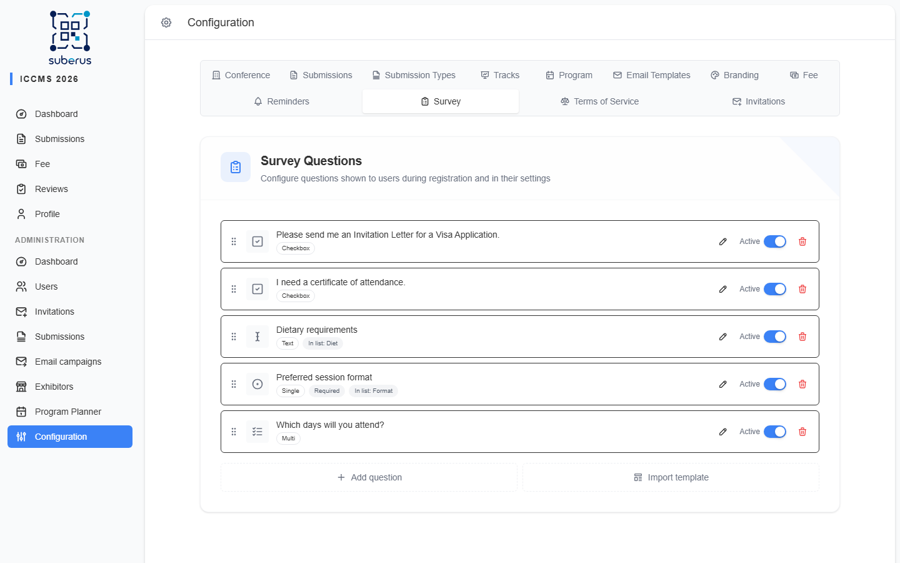
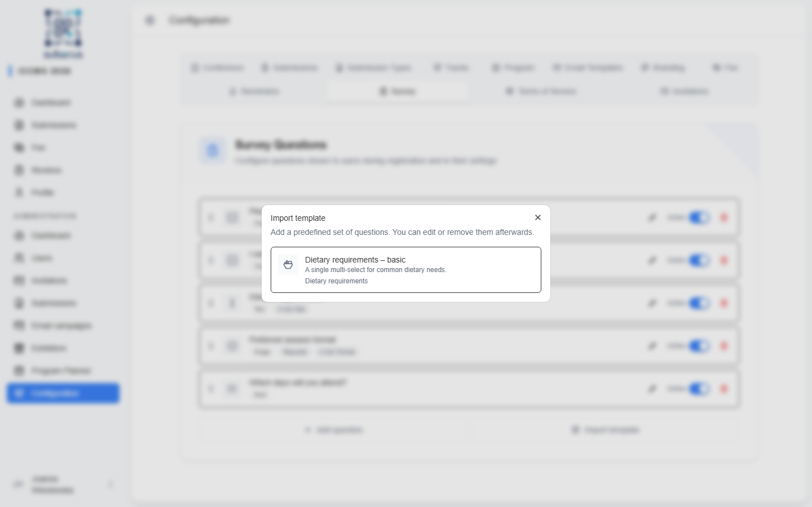

import { Aside, Steps, CardGrid, LinkCard } from '@astrojs/starlight/components';

The **Registration form** tab controls what participants fill in beyond their name and
affiliation: the **Billing details** you need to issue invoices (top of the tab), and
your own **survey** questions (below).

<Aside type="note" title="Where to find it">
**Settings › Registration form.** The Billing details section sits at the top. Below it,
existing survey questions are listed, each with a drag handle to reorder it;
**Add question** opens a dialog for a new one and **Import template** adds a predefined
set in one click.
</Aside>

## Billing details

What participants enter on step 2 of registration (and later in **Profile › Contact &
Invoice Information**) so you can issue them an invoice. The right-hand panel previews
exactly what participants will see as you edit; on a phone, switch between
**Configure** and **Preview** at the top of the section.

🖼️ [Screenshot placeholder: the Billing details section with Invoice required on and the live preview]

### How to collect separate fields

<Steps>

1. Click the **Separate fields** card.

2. Open each field row (Organization name, Street address, Postal code, City) and set its
   **State**: **Required**, **Optional** or **Off**. Optionally give it your own **Label**
   and **Help text**.

3. Check the preview, then click **Save**.

</Steps>

On the registration form, **Organization name** starts filled in with the participant's
affiliation; they can change it, and it stays separate from the affiliation afterwards.
Postal code and City share one row. Under the fields, a **Buyer on your invoice** card shows
participants how their details will appear on the invoice. Participants see the same fields,
labels and card later in **Profile › Contact & Invoice Information**, where they can update them. They can still edit them after their fee is paid: a note then asks them to contact the
conference organizer (linked to the [contact email](/settings/conference/) when set) if an invoice was already
issued, and the change is flagged for you on the [Users](/managing/users/) list.

🖼️ [Screenshot placeholder: registration step 2 in Separate fields mode with the Buyer on your invoice card]

### Switching between Simple and Separate fields

Changing the kind of form — or switching a field **Off** — never deletes or converts
anything. Every participant's data stays where it is.

- **In the settings**, switching the kind shows *N participants entered details in the other
  form. Their data is kept and shown to admins as previous.* above **Save**. Saving is not blocked.
- **You** see such values on the user's page and in the user dialogs under **From previous
  form settings** (read-only); the XLSX export always has all the columns.
- **Simple → Separate fields:** a participant who only filled the text box sees it in their
  profile as **Your previous billing details** above the empty fields. When an AI model is
  configured for Suberus, **Fill fields from this text** splits it into the fields (the VAT ID
  is found by its check digit, not by the AI); only empty fields are filled, and nothing is
  saved until they click **Save**. The card disappears once they save filled fields.
- **Separate fields → Simple:** the profile text box starts with the old fields joined into
  lines, ready to edit; it is saved only when the participant clicks **Save**.
- Details given only in the old form do not count towards Invoice required: such participants
  are **Incomplete** until they fill the current form.

🖼️ [Screenshot placeholder: "Your previous billing details" card in the participant profile]

### Incomplete Billing details

A participant's Billing details are **Incomplete** when they need an invoice (they asked for
one, or Invoice required is on) but a field the current form requires is empty. Admins and
deactivated accounts never count, and an admin's own profile never requires Billing details.

- **Participants** see a banner — *Your billing details are incomplete. Complete them* — on
  their dashboard and profile until the details are complete. It cannot be dismissed. The
  fee page shows the same message, but payment is never blocked.
- **When you make the form stricter** — switch Invoice required on, or set a field to
  **Required** — the section shows *N participants will have Incomplete Billing details once
  you save*. The count already uses your unsaved changes. After saving, filter the users list
  by Incomplete to see who they are. Saving is never blocked.
- **Suberus sends no reminder e-mails on its own.** To remind people, open **Users**, filter
  the **Invoice** column by **Incomplete**, select all, and choose **Send email** or **Send
  announcement** from the bulk actions.

🖼️ [Screenshot placeholder: "N participants will have Incomplete Billing details" warning in the Billing details section]

### VAT ID registry check

When **Validate VAT IDs with VIES and national registries** is on (the default) and a
participant leaves the VAT ID field with a number whose check digit is correct, Suberus looks
it up in a public register and shows the result under the field. Switched off, only the
format and check digit are verified, nothing is sent to a register, and the **Re-check**
button on the user's page is hidden.

| Country of the VAT ID | Register |
|---|---|
| EU countries, Northern Ireland (`XI`) | **VIES** (the EU register of intra-EU traders) |
| Poland | VIES, and the Ministry of Finance **VAT payer list** (biała lista) when VIES does not know the number. A NIP counts as found if either confirms it. |
| Switzerland | Swiss **UID** register |
| Norway | **Brønnøysund** register (only organizations registered for VAT count as found) |
| Anywhere else | No check |

| Status | Shown to the participant |
|---|---|
| Found | ✓ *Found in VIES: (registered name)* (or the name of the other register) — some countries (for example Germany and Spain) and the Polish and Swiss registers do not give the name. |
| Not found | ⚠ *Not found in the registry. Check the number; you can still continue.* |
| Registry unavailable | ⏳ *Registry unavailable, we'll check later.* Several countries take VIES offline at night or at weekends. Suberus retries in the background, less and less often, for up to 72 hours. Nobody is emailed about the result. |
| *(nothing)* | The number is from a country with no register check. |

When the register returns a name or address, a **Use these details** button appears. It fills
only the participant's **empty** fields (or an empty text box in Simple mode) and never
overwrites what they typed. Nothing is filled until they click it.

The check is **advisory only**: it never blocks registration or a profile save. A result
is reused for 24 hours; the number is checked again when it changes, also when you or the
AI assistant change it. There is no periodic re-check. Lookups that no participant kept are
deleted after a day. The AI assistant reads the last result of each user's VAT ID.

🖼️ [Screenshot placeholder: VAT ID field with the "Found in VIES" status]

### How to require an invoice from everyone

<Steps>

1. Switch on **Invoice required**. The preview drops the "I need an invoice" checkbox
   and marks the Billing details field as mandatory.

2. Open the **Text box** row and, optionally, give the field your own **Label** and
   **Help text** (for example, which details your accounting needs).

3. Click **Save**.

</Steps>

<Aside type="caution">
Invoice required applies to new registrations and to profile saves from then on.
Participants who registered earlier without Billing details are not blocked, but they
must fill them in the next time they save their profile. Accounts you create yourself
in **Users** are exempt.
</Aside>

| Field | What it does | What to enter / Notes |
|---|---|---|
| **Invoice required** | Every participant must give Billing details; the "I need an invoice" checkbox disappears and their account is marked as needing an invoice. | Off by default. When off, participants tick "I need an invoice" themselves (unticked by default) and the details become mandatory only then. |
| **Simple** / **Separate fields** | How participants enter the details: one free-text box, or separate fields. | **Simple** is the default. Switching keeps every participant's data; nothing is converted or deleted. |
| **Text box › Label** | *(Simple)* The field's label on the registration form and profile. | Up to 60 characters. Leave empty to use the built-in "Billing details (organization)", shown as the placeholder. |
| **Text box › Help text** | *(Simple)* A hint shown under the field. | Up to 300 characters. Leave empty to show nothing. The text box itself is always required once an invoice is needed. |
| **Organization name**, **Street address**, **Postal code**, **City** | *(Separate fields)* The fixed set of fields. Each row shows its state; open it to change it. | You cannot add your own fields — use [survey questions](#survey) for anything else. Country is the participant's existing Country, not a separate billing field. |
| **VAT ID** | *(both kinds)* The tax number of the organization being invoiced. Shown beside the text box in **Simple**, and with the other fields in **Separate fields**. | Off by default. Participants may leave out the country prefix: it is added from their Country (Greece gets `EL`). For the EU, Switzerland, Norway, the UK (`GB`, `XI`) and Andorra the number is stored uppercase without spaces or dashes, and a wrong number is rejected by its check digit. For other countries it is stored as typed (uppercase) and only the characters and length (20) are checked. The same check applies when you edit a user and to the AI assistant. **Required** applies only to participants from those countries (or with no Country): for anyone else, e.g. from the USA, the VAT ID stays optional. |
| *(field)* **› Label** | The field's label for participants. | Up to 60 characters. Leave empty for the built-in English name, shown as the placeholder. |
| *(field)* **› State** | **Off** hides the field, **Optional** shows it, **Required** makes it mandatory once an invoice is needed. | All fields start **Off**, so turn on at least the ones your accounting needs. |
| *(field)* **› Help text** | A hint shown under the field. | Up to 300 characters. Leave empty to show nothing. |
| **Validate VAT IDs with VIES and national registries** | Looks participants' VAT IDs up in VIES and the Polish, Swiss and Norwegian registers. | On by default. Off: only the format and check digit are verified. |
| **Organizer's EU VAT ID** | *(Shown while the switch above is on.)* Your own VAT ID, sent to VIES as the requester when a saved VAT ID is checked (after registration, a profile save, your edit or **Re-check**). VIES then returns a consultation number. Suberus keeps every such number, one per check, as proof that you checked (not shown in the app yet). The quick check while someone types a VAT ID during registration is sent without it, so it leaves no consultation number. | Optional, empty by default. Must be an EU or Northern Ireland (`XI`) VAT ID with a correct check digit. VIES checks only its format, not whether it is registered. |

## Survey

Build your own questions that users answer during registration and can revisit in
their settings — for example dietary requirements, t-shirt size, or consent checkboxes.
You control the order, the question type, and whether each answer appears as a column
in the users list.

### How to add a question

<Steps>

1. Click **Add question** to open the editor dialog, and type the question **Label**.

2. Choose a **Type** from the visual picker (see the table below). For
   *Single Select* / *Multi Select*, add the **options** (drag the handle to
   reorder them) and switch on **Allow 'Other'** if answers won't always fit the
   preset options.

3. Pick the **Audience** (only shown when the exhibitors feature is enabled), set
   whether it's **Required**, and whether to **show it in the users list** (and, if
   so, the short column name). The **Preview** panel shows exactly how users will
   see the question as you edit.

4. Click **Add** to save. Back in the list, drag the **handle** to reorder, use
   the **Active** switch to show/hide it, the **pencil** to edit, and the
   **trash** to delete.

</Steps>

### Importing a template

Templates are predefined question sets you can drop in instead of building from
scratch, then edit or remove like any other question.

<Steps>

1. Click **Import template** to open the picker.

2. Click a template card to add its questions. They're appended to the end of the
   list and behave exactly like questions you added manually.

3. Reorder, edit, or delete the imported questions as needed.

</Steps>

| Template | Adds |
|---|---|
| **Dietary requirements – basic** | A *Multi Select* "Dietary requirements" (Vegetarian, Vegan, Gluten-free, Lactose-free, Halal, Kosher, Nut allergy) with **Allow 'Other'** on. |

### Question fields

| Field | What it does | What to enter / Notes |
|---|---|---|
| **Label** | The question text users see. | Required. |
| **Type** | The kind of answer. | **Checkbox** (yes/no), **Text** (free text), **Single Select** (one of many), **Multi Select** (several of many). |
| **Audience** | Who the question is shown to. | **Everyone**, **Participants** (authors and other non-exhibitor users), or **Exhibitors** only. Appears only when the exhibitors feature is enabled; existing questions default to **Everyone**. |
| **Options** | The choices for select questions. | Required for *Single/Multi Select*; add/remove rows. Ignored for Checkbox/Text. |
| **Allow 'Other'** | Adds an *Other* choice with a free-text box for answers the options don't cover (e.g. allergies). | *Single/Multi Select* only. Other answers appear as `Other: …` in the users list and export. |
| **Required** | Whether users must answer. | On/Off. *Other* selected with an empty text box counts as unanswered. |
| **Show in users list** | Surfaces the answer as a column in *Managing › Users*. | On/Off. |
| **Field name** | The short column header used when shown in the list. | Appears only when *Show in users list* is on. Keep it short. |
| **Active** | Whether the question is currently shown to users. | Toggle per question in the list. Turn off to retire without deleting. |

<Aside type="tip">
Order matters — users see questions in the order shown here. Put the most important
(or required) questions first by dragging them up.
</Aside>

## Related

<CardGrid>
	<LinkCard title="Terms of Service" href="/settings/terms-of-service/" description="Also shown during registration." />
	<LinkCard title="Users" href="/managing/users/" description="Where answers marked 'Show in users list' appear." />
</CardGrid>
